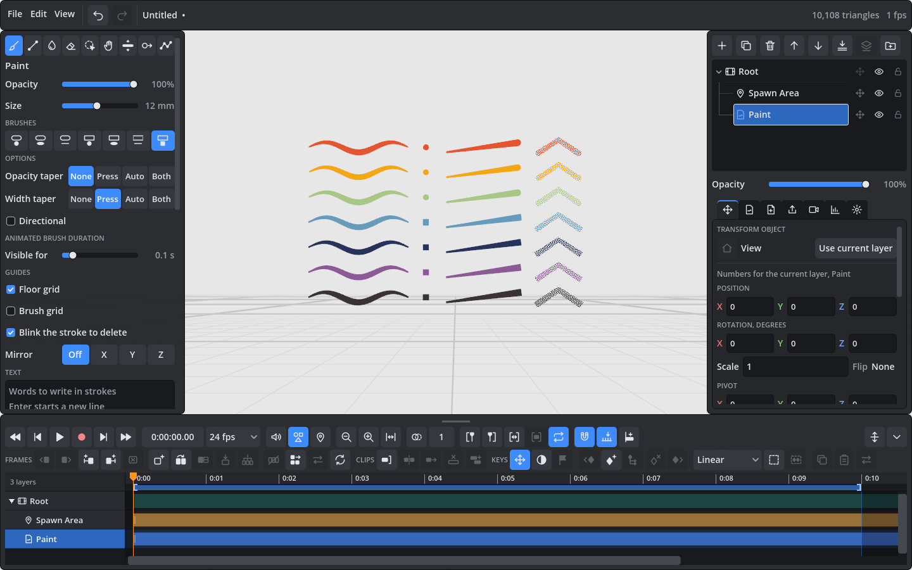
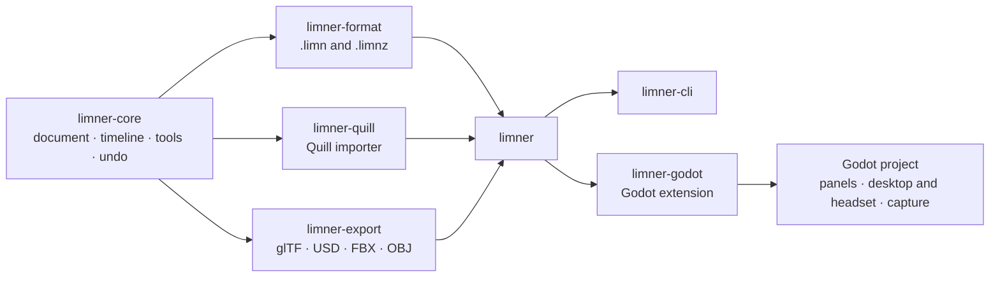

<p align="center">
  
</p>

<p align="center">
  <strong>Paint and animate in 3D, in a VR headset or at your desk.</strong><br>
  An open-source successor to Quill.
</p>

<p align="center">
  <a href="LICENSE"></a>
  
  
  
</p>

---

Limner is a tool for painting in three dimensions and bringing the paintings to life. You paint with your hands in the air, walk around what you made, and animate it frame by frame or with keys, the way Quill made possible.

Quill shaped a whole community of VR artists and animators, and it has not changed since version 2.9. Limner keeps its way of working, opens existing Quill projects, and adds what artists have been asking for: **lights that shade the paint**, mirrored painting, text, smooth keys, an open file format, and export to the 3D formats used today.

> [!NOTE]
> **Early days.** Everything in the plan is built and tested on macOS, where Limner runs on the desktop and with a simulated headset, and on Windows, where it runs on the desktop. It has not yet run on a real headset or on a Quest; that is the next step. [What has and has not been verified](docs/handoff.md) is written down.

## Highlights

<table>
<tr>
<td width="50%" valign="top">

**🖌️ Paint in space**<br>
Nine tools (Paint, Line, Colorize, Eraser, Selection, Grab, Thicken, Nudge, Optimize), seven brushes, pressure, tapers and fourteen colour modes. Mirror your strokes across any axis, write text in strokes, and see a small grid around the brush when you want one.

</td>
<td width="50%" valign="top">

**🎞️ Animate**<br>
Frames and holds with onion skins, clips and looping sequences, keys with six easings, recording a hand's motion, painting while the piece plays, chapter marks, and a timeline built for both the mouse and the controller.

</td>
</tr>
<tr>
<td valign="top">

**💡 Light the scene**<br>
Sun, point and spot lights shade the layers you choose, with shadows and an ambient level. Bake the light into the paint so the look survives without the lights and in every export.

</td>
<td valign="top">

**🥽 Headset or desktop**<br>
In a headset the controls follow Quill's: trigger to paint, grips to move the world, a palette of panels in the other hand. On a desktop the same tools and panels work with a mouse or a pen.

</td>
</tr>
<tr>
<td valign="top">

**📂 Open files**<br>
Its own documented format (<code>.limn</code> folders and <code>.limnz</code> files), crash-safe saving and autosave. Quill projects open directly.

</td>
<td valign="top">

**📤 Share it**<br>
Export to glTF, USD/USDZ, FBX and OBJ with hierarchy, animation, lights and cameras. Render stills, 360 stills and camera moves to video.

</td>
</tr>
</table>

## A look

<p align="center">
  <picture>
    <source media="(prefers-color-scheme: light)" srcset="docs/images/desktop-light.png">
    
  </picture>
</p>
<p align="center"><sub>The desktop interface, in the dark or light scheme to match your GitHub theme. The same panels ride on the hand in a headset.</sub></p>

## Download

**Windows 10 and 11 (64-bit):** download [Limner-0.1.0-windows-x64.zip](https://github.com/lvnr/limner/releases/latest/download/Limner-0.1.0-windows-x64.zip) from the [latest release](https://github.com/lvnr/limner/releases/latest), unzip it anywhere and double-click `Limner.exe`. Nothing else needs installing.

- The app is not signed yet, so Windows SmartScreen says "Windows protected your PC" the first time. Choose **More info**, then **Run anyway**.
- With a headset connected through Meta Quest Link, SteamVR or another OpenXR runtime, Limner starts in the headset; otherwise it opens on the desktop. Headset support has not been tried on real hardware yet.
- It draws with Vulkan, which most graphics cards and chips from the last several years support; keep the graphics driver up to date.

There is no download for macOS or Linux yet: build from source as below.

## Getting started

You need [Rust](https://rustup.rs) (stable) and Git. The scripts download the pinned Godot build. On Windows, Rust also needs the Visual Studio Build Tools with "Desktop development with C++".

```bash
git clone https://github.com/lvnr/limner.git
cd limner
scripts/fetch-godot.sh            # once; on Windows: scripts\fetch-godot.ps1
cargo build -p limner-godot       # the Rust part the app loads
scripts/godot.sh --path godot     # run Limner; on Windows: scripts\godot.ps1 --path godot
```

With a headset connected through OpenXR, Limner starts in it. Add `-- --desktop` to stay on the desktop, or `-- --xr --sim` to try the headset interface with a simulated headset driven by the mouse.

| Do | Run |
|---|---|
| All tests | `scripts/test.sh` (Windows: `scripts\test.ps1`) |
| A packaged app | `scripts/package.sh` (Windows: `scripts\package.ps1`) |
| Inspect a project | `cargo run -p limner-cli -- inspect <project>` |
| Export from the command line | `cargo run -p limner-cli -- export <project> scene.glb` |

## Platforms

| System | Desktop | Headset | Where it stands |
|---|---|---|---|
| macOS, Apple silicon | ✅ | (no OpenXR runtime on macOS) | Built, tested and packaged |
| Windows | ✅ | Rift, Quest over Link, other OpenXR headsets | Built, tested and packaged on the desktop; not yet tried with a headset |
| Linux | expected | SteamVR or Monado | Not tried yet; a CI workflow that runs every test on it is ready |
| Quest, standalone | | planned | The build steps are written down in [docs/xr.md](docs/xr.md) |

## How it is built

A Rust core that knows nothing of any engine holds the document, the timeline, the tools and undo. Every edit is a small command, so the desktop interface, the headset interface, the command line and the tests all drive the same thing. A Godot 4.8 project draws the result and provides the interface, the headset layer, sound and capture.



## Documentation

| Read | For |
|---|---|
| [docs/handoff.md](docs/handoff.md) | What is built, what has been verified, setting up on another machine, the first session in a headset |
| [docs/quill-differences.md](docs/quill-differences.md) | Where Limner differs from Quill, and why |
| [docs/format.md](docs/format.md) | The file format, written so that others can read and write it |
| [docs/export.md](docs/export.md) | What each export format holds and how to bring it into other programs |
| [docs/capture.md](docs/capture.md) | Stills, 360 stills and camera renders |
| [docs/quill-import.md](docs/quill-import.md) | Opening Quill projects |
| [docs/xr.md](docs/xr.md) | The headset layer, and how to build for a Quest |
| [docs/interface-api.md](docs/interface-api.md) | Writing interface code: every command and query |
| [docs/roadmap.md](docs/roadmap.md) | What could come next |

## Contributing

Issues and pull requests are welcome, from bug reports to features. Behaviour belongs in the Rust core with a test, and the Godot side only presents it; [CLAUDE.md](CLAUDE.md) holds the project's conventions and commands (it is written for AI coding sessions, but it is a good read for people too). Run `scripts/test.sh` before sending a change.

The most useful help right now is trying Limner on a headset or on Windows and saying what happens.

## Relationship to Quill

Limner is an independent project. It is not affiliated with or endorsed by Smoothstep, Meta or the authors of Quill, and it contains no code or assets from Quill. It reads Quill project folders so that existing work stays usable, and writes its own open format.

## Licence

[MIT](LICENSE).
